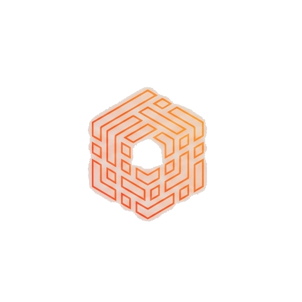

# PreHack OS

**Learn. Practice. Analyze. Report.**

PreHack OS is a Debian-based cybersecurity learning environment that brings a desktop, offline lessons, local training labs, security tools, and a learning dashboard into one bootable image. It is intended for students, instructors, and people building practical security skills in a controlled environment.

This repository documents and distributes **PreHackOSbv8.iso**, identified inside the image as **PreHack OS 3.0 Learning Edition**. The `bv8` release label preserves the supplied image's filename.

**[Download and verify the ISO](DOWNLOAD.md)** · **[Read the project write-up](WRITEUP.md)** · **[Review verification results](VERIFICATION.md)**

## What is included

- **Debian 13 (trixie), amd64:** a familiar Linux foundation with APT package management.
- **XFCE desktop:** PreHack branding, a dark theme, custom wallpaper, icons, and boot presentation.
- **PreHack Control Center:** a central interface for lessons, labs, tools, progress, challenges, reports, and system information.
- **14 offline lessons:** foundations, Linux, networking, web security, forensics, and CTF topics.
- **Local Docker labs:** bundled image archives for OWASP Juice Shop, DVWA, WebGoat, a local network range, and adaptive practice components.
- **PreHack AI:** local documentation help plus optional connections to configured AI providers.
- **Calamares installer:** a graphical path from a live session to an installed learning environment.
- **Boot choices:** normal startup, safe graphics, forensic local-lab mode, copy to RAM, and troubleshooting options.

## Start in a virtual machine

The bundled guide suggests **2 CPU cores, 4 GB RAM, and a 64 GB virtual disk**. More CPU and memory are useful when running several containers. These are configuration suggestions from the image's documentation, not measured minimums from a performance test.

1. Download both ISO parts from the **bv8** release and reconstruct the ISO using [the download guide](DOWNLOAD.md).
2. Create an amd64 Debian virtual machine and attach `PreHackOSbv8.iso` as its optical disk.
3. Choose **Start PreHack OS** from the boot menu.
4. The bundled guides specify the default account as **`prehack` / `prehack`**.
5. Open **PreHack Control Center** and begin with an offline lesson.
6. For persistent learning progress and larger Docker labs, install onto the VM's virtual disk using **Install PreHack OS**.

Change the default password on an installed system. Keep intentionally vulnerable training applications inside your lab environment, and use security tools only on systems you own or have permission to assess.

Live sessions use temporary writable storage. The ISO's documentation recommends a real writable disk for Docker labs and an installed VM for persistent use. Copy-to-RAM mode needs enough additional memory to hold the live image.

## Release identity

| Field | Value |
| --- | --- |
| Release label | `bv8` |
| Product identity inside the ISO | PreHack OS 3.0 Learning Edition |
| Bundled application version | `3.0.0` |
| Base distribution | Debian GNU/Linux 13 (trixie) |
| Architecture | amd64 / x86-64 |
| ISO volume label | `PreHack OS 3 Live` |
| ISO metadata date | September 28, 2026 |
| Original filename | `PreHackOSbv8.iso` |
| Original size | 3,570,057,216 bytes (about 3.33 GiB) |
| SHA-256 | `dbd04756ddd02e9cf76b6779d3681be5ad34cfdec4f358ab460a40c260b689f8` |

## Repository scope and licenses

This is a release and documentation repository for the supplied ISO. A matching source commit for this image has not been established, so the repository's documentation commit should not be treated as the image's build-source revision.

The image contains third-party packages and training applications with their own licenses. No new blanket license is assigned to those components. Consult the notices inside the image, including `/usr/share/doc/<package>/copyright`, and the respective upstream projects.
